# TypeTorch docs

TypeTorch updates live Roblox games **without restarting their servers**. You write the game in
[roblox-ts](https://roblox-ts.com). Each build becomes one artifact (an uploaded, private Model asset), and every live
server hot-swaps to it in a few seconds while players stay in the game.

> **Status: early.** The core loop runs on live Roblox servers today. APIs and commands still change. These docs
> describe the code as it is now. Features that don't exist yet are marked **planned**.

> **Your game never builds or deploys in CI.** TypeTorch ships no workflows for games, and nothing needs your Open Cloud
> key or signing keys in a hosted CI: builds, cloud tests, signing and deploys run on your own machine. (TypeTorch's own
> packages are released from a version tag by a GitHub workflow with npm trusted publishing; see
> [Releases](#releases).)

## Get started

Pick one path:

| You have | Start here | Time |
|---|---|---|
| Nothing yet: a new game | **[Fresh setup](getting-started/fresh-setup.md)**: `bunx @typetorch/cli init` in an empty folder, or every step by hand; from zero to a live hot-swap | under an hour with `init` |
| A roblox-ts game | **[Migrate an existing game](getting-started/migrate.md)**: services, swap safety, networking, data, UI; with live players, inside the [go-live checklist](guides/go-live-checklist.md) | a few hours to days; about a week with live players |
| An AI coding agent | **[Agent playbook](agents/AGENTS.md)**: tell your agent "migrate this project to typetorch" | |

TypeTorch is **roblox-ts only**. A plain Luau game has to move to roblox-ts first.

## How it works

```mermaid
flowchart LR
    A[typetorch deploy] --> B[build: roblox-ts -> payload.rbxm]
    B --> C[upload as a private Model asset<br/>moderation check]
    C --> T[cloud test<br/>prod: always]
    T --> D[approve y/N<br/>prod: signed]
    D --> E[deploy message<br/>MessagingService]
    E --> F[live servers: the kernel loads the payload]
    F --> G[old version stops, new one starts<br/>server + clients, no restart]
    G --> R[reports to the fleet API<br/>bad build: automatic rollback]
```



- **Kernel:** a small Luau loader baked into the place. It picks each server's branch, loads payloads and swaps them.
  It is the only part that needs a place publish and a server restart to change.
- **Payload:** your compiled game code (ModuleScripts only), uploaded once per build.
- **Framework:** `@typetorch/framework`, the roblox-ts library your game uses: modules with dependency injection and
  lifecycle hooks, troves for cleanup, guarded networking, UI helpers, hot assets and the in-game dev menu. It ships
  inside every payload, so it hot-swaps too.
- **Branches:** public servers run `prod`. Any other branch (`dev`, `feature-x`) runs in private or reserved servers of
  the same game.
- **CLI:** `typetorch` (or the short alias `tt`) builds, uploads, tests, approves, signs and deploys, rolls back, shows
  live servers and alerts, patches the kernel into the place, and runs the Studio loop (`typetorch serve`).
  `typetorch update` keeps it current.
- **Studio plugin:** attaches Studio to `typetorch serve` by itself, reloads a running playtest on save, publishes hot
  assets from a panel, and opens a Claude chat.
- **Safe deploys:** a cloud test before every prod publish; on each server a health window that rolls a failing build
  back; `deploy --wait`, which rolls the branch back when a build fails on 20% of servers; a new server plays within
  15 s.
- **Backend (optional, self-hosted):** live server status, deploy reports, alerts, error logs and debug bundles from
  the kernel, your own analytics with experiments, funnels and player journeys, and a web explorer.

## Guides

| Guide | What it covers |
|---|---|
| [Branches and channels](guides/branches-and-channels.md) | `prod` and `dev`, private servers on a branch, `/tt new`, owners switching any server in place, `branch rm` |
| [Deploy and rollback](guides/deploy-and-rollback.md) | deploy, approval, safe deploys (cloud test, health window, `--wait` and automatic rollback, reports), promote, rollback, the backup build (automatic refresh, `--reupload`), the build cache, pins, kernel updates |
| [Live servers and alerts](guides/fleet-and-alerts.md) | the fleet API, `typetorch servers`, `report`, `alerts`, server lost and stuck, webhooks, error logs, debug bundles, remote debug in the explorer, debugging endpoints |
| [Settings](guides/settings.md) | the signed settings record: dev access, fleet, analytics and your own live values (`liveConfig`), `typetorch settings` |
| [Cross-server messages](guides/messaging.md) | `TypeTorch.messaging` (one kernel-held topic, dev branches kept off prod, limits), `TypeTorch.servers()` |
| [Loading screens](guides/loading-screen.md) | your own loading screen: `ClientReady`, `Holding`, `TypeTorchBootScreen`, `TypeTorchKernelScreen` |
| [Analytics](guides/analytics.md) | `AnalyticsEngine`, the event format, DuckDB or Basin, experiments and live overrides (`typetorch experiment`), the web explorer, queries, node graphs, privacy, a local quick start |
| [Prod signing](guides/prod-signing.md) | the Root Key and Fallback Key, `typetorch keys`, kernel 0.3 verification, bootstrap heads, the boot fail-safe |
| [Player data](guides/player-data.md) | the swap-safe data pattern (library writes as DataHost jobs or `TypeTorch.runDetached`), ProfileStore and ProfileService examples, the cloud test and developer product receipts |
| [State with charm](guides/state.md) | charm atoms across swaps: server atoms from `persist`, charm-sync over `createNetwork`, the client's hydrate request |
| [Go-live checklist](guides/go-live-checklist.md) | moving a game with live players: prepare, a copy, a dev-branch soak, live tests, cut-over, what to do if it goes wrong |
| [Hot assets](guides/hot-assets.md) | models and UI templates from the place, updated live with `hotAsset()`; from the CLI or the Studio plugin |
| [Testing in Studio](guides/studio-testing.md) | `typetorch serve` and the Studio plugin: your local code with the real kernel, live reload in a playtest, agents driving Studio, a Studio on another machine |
| [The dev menu](guides/dev-menu.md) | every tab, owners and devs, the `/tt` commands |
| [Runtime API](guides/runtime-api.md) | `TypeTorch.*`: identity, start info, swap events, persist, playerState, `Dependency<T>()`, roles, logs, messaging, live settings |
| [Networking](guides/networking.md) | `createNetwork`, guards, limits, requests, timeouts, `emit` |
| [Coming from Flamework](guides/from-flamework.md) | `typetorch migrate --from flamework` (the codemod and its report), `createFlameworkCompat`, the mapping |
| [remote-claude](guides/remote-claude.md) | prompt Claude Code from inside a dev server or from Studio (`serve --claude`): Live and Code modes, screenshots, Toolbox |
| [Security model](guides/security.md) | who can do what, dev access (`access push`), keys, signing, remote Studios, never publish secrets |
| [Troubleshooting](guides/troubleshooting.md) | real errors and their fixes |

## For agents

- [agents/AGENTS.md](agents/AGENTS.md): the migration and setup playbook for any coding agent (Claude Code, Codex,
  Cursor and others).
- [agents/skills/typetorch-migrate/SKILL.md](agents/skills/typetorch-migrate/SKILL.md): the same playbook as a Claude
  Code skill.
- Claude Code plugin (works once the `typetorch/claude-plugin` repo is on GitHub):

  ```text
  /plugin marketplace add typetorch/claude-plugin
  /plugin install typetorch@typetorch
  ```

  Then say "migrate this project to typetorch", or run `/typetorch:typetorch-migrate`.
- [llms.txt](llms.txt): an index of these docs for LLMs.

## Repositories

| Repository | What it is |
|---|---|
| [kernel](https://github.com/typetorch/kernel) | the Luau loader baked into the place |
| [framework](https://github.com/typetorch/framework) | `@typetorch/framework`, the roblox-ts framework (ships in every payload) |
| [cli](https://github.com/typetorch/cli) | `@typetorch/cli`: `typetorch` (alias `tt`), the command line tool |
| [studio-plugin](https://github.com/typetorch/studio-plugin) | the TypeTorch Studio plugin (`TypeTorchSync.rbxm` on GitHub releases; not on npm) |
| [template](https://github.com/typetorch/template) | the starter game (Target Rush), also the reference setup |
| [transformer](https://github.com/typetorch/transformer) | `@typetorch/transformer`, the compiler plugin for guards and dependency injection |
| [dev-server](https://github.com/typetorch/dev-server) | `@typetorch/dev-server`, `remote-claude`: Claude Code on your PC, prompted from inside a dev server or from Studio |
| [backend](https://github.com/typetorch/backend) | the backend: analytics (DuckDB, or Basin), the fleet API (SQLite), error logs, debug bundles and the web explorer (run from a checkout or its Docker image; not on npm) |
| [dash](https://github.com/typetorch/dash) | `dash.typetorch.dev`: one Roblox sign-in for every backend you own or view (optional) |

## Conventions in these docs

- Commands work in PowerShell 5.1 and bash unless a block says otherwise.
- `bun run typetorch <command>` runs the CLI: `@typetorch/cli` from npm, in the game's dev dependencies with the
  script `"typetorch": "typetorch"` (the template has both; see
  [fresh setup](getting-started/fresh-setup.md#2-get-the-code)). Without it, `npx @typetorch/cli <command>` does the
  same. Installed globally (`npm i -g @typetorch/cli`), it is `typetorch <command>` or `tt <command>`.
- Ids in examples are fake: universe `1234567890`, place `9876543210`, group `1234567`, user `111111111`.

## Releases

The npm packages (`@typetorch/cli`, `kernel`, `framework`, `transformer`, `dev-server`) are published only from a
version tag: a maintainer runs `npm version <x.y.z> -m "release %s" && git push origin main --follow-tags`, and the
repo's `publish.yml` workflow checks that the tag matches `package.json`, runs the package's `prepublishOnly` checks,
publishes with provenance through npm trusted publishing (`x.y.z-next.N` goes to the `next` dist-tag, anything else to
`latest`) and makes the GitHub release. The workflows still accept an `NPM_TOKEN` repository secret as a fallback. No
workflow runs on pull requests except the CLI's tests (`ci.yml`).

The Studio plugin is released the same way, from a tag, as `TypeTorchSync.rbxm` on its GitHub release. Roblox doesn't
accept plugin uploads through Open Cloud yet (the release job warns and skips that step), so the Creator Store copy is
published by hand in Studio with **Publish as Plugin**. Install from the GitHub release
([Testing in Studio](guides/studio-testing.md#set-up-once)).

## Logo

The TypeTorch logo, its PNG and favicon exports, colours and usage rules are in [brand/](brand/README.md).

## License

MIT
