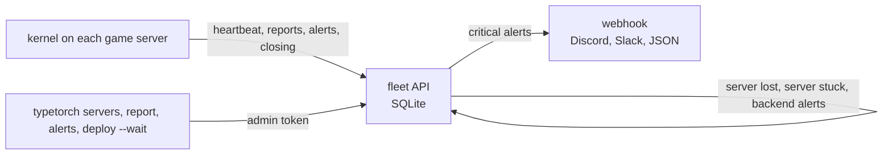

# Live servers and alerts

See every live server of your game, what each one did with a deploy, and get an alert when something breaks, within
seconds. The **kernel** sends it, so it keeps working when a build is broken and the game's own code doesn't run.

- Needs kernel 0.3.2+ in the place (a place project that maps the kernel's files one by one must map `Fleet` too; the
  template's `studio.project.json` does).
- Backend: the **fleet API**, a small server you host (SQLite inside). It is part of the
  [backend](https://github.com/typetorch/backend) and runs in the same process as its DuckDB analytics part, or alone.
- Without it everything else still works: `servers`, `report` and `alerts` say "not configured" in one line, and
  deploys skip their wait with a note.

## How it works



Each game server posts, with a write-only token:

| What | When |
|---|---|
| **Heartbeat** | every 30 s, and at once on a swap, a health change or a player count change. Branch, build, `#seq`, players, health (`ok`, `failed`, `unverified`, `degraded`, `backup`), kernel version, uptime, last error, the place version (`pv`, kernel 0.5.6+), the budget summary and TPS. Kernel 0.5.7+: the game's [live debug](runtime-api.md#live-debug-server-only) declarations and column values |
| **Deploy report** | one per deploy outcome: `booted`, `swapped`, `failed`, `rolled_back` or `skipped`, with the error and the seconds it took |
| **Alert** | at once ([codes below](#alerts)) |
| **Closing notice** | when the server shuts down cleanly (so it isn't "lost") |

That is under about 6 requests a minute per server, capped at 30 (Roblox allows 500 a minute per server, shared with
your game). Failed posts are retried; a post never blocks a swap. The token is never logged.

**No MemoryStore for fleet data.** Heartbeats and reports never touch your experience's MemoryStore, whose quota your
game shares. (The kernel still keeps each branch's head there: one small key.)

## Set it up

`bun run typetorch init --phase backend` (CLI 0.10+) does steps 1 to 3 for you: on a VPS with Coolify, on a VPS
without Docker, or on your PC behind a quick tunnel. It makes the two keys, writes them to `.env`, and points the game
at the backend. The steps below do the same by hand.

1. **Run the backend.** On a VPS with a domain ([Deploy on Coolify](https://github.com/typetorch/backend#deploy-on-coolify)
   or [run it on a VPS without Docker](https://github.com/typetorch/backend#run-it-on-a-vps-without-docker)), or on your PC
   behind a quick tunnel for a test ([analytics quick start](analytics.md#quick-start-a-local-test)). For a game on
   Cloudflare Basin, run only its fleet part: `TYPETORCH_PARTS=fleet`. It needs two random values, 32+ characters each
   and different: the game key `TYPETORCH_API_KEY` and the admin token `TYPETORCH_ADMIN_TOKEN`.
2. **Give the CLI the keys.** In the game repo's `.env` (gitignored):

   ```text
   TYPETORCH_ADMIN_TOKEN=<admin token>
   TYPETORCH_API_KEY=<game key>
   ```

   The game key only writes; the admin token reads and manages. The CLI never prints them or passes them to a child process.
3. **Point game servers at it:**

   ```sh
   bun run typetorch backend setup --url https://backend.example.com
   ```

   It writes `backend` = `{ url, key }` (the game key) into the game's [signed settings record](settings.md), with the
   `fleet` and `analytics` sections that kernels before 0.4 read derived from it, and `"backend": { "url": ... }` into
   `typetorch.json`, then pings the servers and sends the owner list to the backend. It needs both prod signing keys (the record
   is signed; servers refuse one that doesn't verify) and kernel 0.3.8+. `--dry-run` shows what it would write;
   `bun run typetorch settings status` shows the record (the token hidden). Before it signs anything it
   [checks](settings.md#checked-before-it-is-signed) the address (https, `GET /healthz` within 5 s) and the game key (not
   the admin token) and refuses a broken one with a fix; `--force` writes anyway.
4. **Check:** kernels read the record at boot, about every minute, and within seconds of a ping. Join a server, then
   `bun run typetorch servers`.

- **On this PC:** `bun run typetorch backend run` starts a backend checkout behind a Cloudflare quick tunnel and runs
  `backend setup --url <tunnel>` each time the tunnel's address changes, so servers follow it within seconds (`init`
  sets it up and registers it as a login task). The explorer is then `http://localhost:8787`.
- **Sign in with typetorch.dev:** a backend with a public https URL can let owners sign in through
  [dash.typetorch.dev](https://dash.typetorch.dev) instead of a Roblox OAuth app per game. Owners get admin only
  on a trusted browser (by default; the backend's `TYPETORCH_CENTRAL_LOGIN_UNBLESSED` decides):
  `bun run typetorch backend bless` signs a one-time link with your main prod key and opens it in the browser to trust.
  Details: the [backend README](https://github.com/typetorch/backend#sign-in-with-typetorchdev).

## Commands

```sh
bun run typetorch servers
bun run typetorch servers --branch prod --watch
bun run typetorch report latest
bun run typetorch report "#42"
bun run typetorch alerts --since 120
bun run typetorch alerts --follow --level critical
```

- **`servers [--branch <b>] [--watch]`:** every live server: JobId, branch, build, applied `#seq`, health, players,
  kernel, uptime, last heartbeat. `--watch` redraws every 5 s. Reserved-server access codes are never shown.
- **`report <seq|artifact|latest> [--branch <b>]`:** what the servers did with one deploy: counts per result, errors
  grouped with the servers that hit them, and the servers still on an older `#seq`. It exits 1 when a server failed or
  rolled back, and prints the rollback command.
- **`alerts [--follow] [--level info|warning|critical] [--since <minutes>]`:** the last 60 minutes by default;
  `--follow` keeps printing new ones.
- **`deploy --wait`** reads the same reports: [Deploy and rollback](deploy-and-rollback.md#wait-and-automatic-rollback).

In PowerShell, quote `"#42"`.

## Alerts

| Code | Level | From | Means |
|---|---|---|---|
| `deploy_failed` | critical | kernel | a deploy didn't load or start on a server |
| `health_rollback` | critical | kernel | a new build failed its health window and the server went back to the last good one |
| `lkg_exhausted` | critical | kernel | nothing known-good could run after a failure |
| `backup_build` | critical | kernel | 0.3.6: nothing else could run, so the backup build baked into the place runs ([never an empty server](deploy-and-rollback.md#never-an-empty-server)) |
| `boot_failed_teleport` | critical | kernel | 0.3.6: nothing runs at all; players are being moved to another server |
| `bounce_kick` | critical | kernel | 0.3.6: a player was kicked after 3 moves (or failed teleports) |
| `client_failed` | warning | kernel | 0.3.6: a player's game code didn't start even after a re-send; they were moved |
| `health_failed`, `health_unverified` | critical | kernel | the server runs nothing, or booted an unverified prod build. Kernel 0.5.7+: no health tick counts while a swap or a last-known-good restore runs, and a worse state alerts only after 2 ticks (5 s apart) in a row; older kernels could raise a false `health_failed` mid-swap or during a slow boot that nothing cleared. A server where nothing can run still alerts, about 5 s later |
| `health_degraded` | warning | kernel | the running build keeps erroring, or a deploy failed here |
| `booted_unverified`, `no_trusted_head` | critical | kernel | [prod signing](prod-signing.md) problems at boot |
| `kernel_api_mismatch`, `artifact_refused` | critical | kernel | a build the kernel can't or won't run |
| `error_spike` | warning | kernel | 20 or more errors a minute from the running build |
| `refused_deploy`, `refused_head`, `refused_pin`, `refused_swap` | warning | kernel | the kernel refused a message or a swap (for example an unsigned one on prod) |
| `branch_switch`, `build_load` | info | kernel | someone switched this server's branch or loaded a build on it (the dev menu, `/tt branch`, `/tt pin`) |
| `auto_rollback` | critical | CLI | `deploy --wait` rolled the branch back |
| `server_stuck` | warning | CLI and fleet API | servers didn't pick up a deploy (below) |
| `server_lost` | critical (3+ servers) or warning | fleet API | servers stopped reporting (below) |
| `fleet_flood` | critical | fleet API | too many never-seen JobIds in a minute (below) |
| `disk_low` | warning or critical | backend | the backend's data disk is under `TYPETORCH_DISK_WARN_PERCENT` (15) or `TYPETORCH_DISK_CRITICAL_PERCENT` (5) percent free |
| `backend_*` | below | backend | the backend's own checks of its data ([below](#backend-alerts)) |

The kernel sends each code at most once a minute per server (`error_spike` every 5 minutes; `branch_switch` and
`build_load` every time).

- **Server lost:** no heartbeat for 90 s and no closing notice. One alert per branch and build per sweep, with the
  JobIds; critical when 3 or more servers are lost at once.
- **Server stuck:** 3 minutes after a deploy started, live servers on its branch are still below its `#seq` and haven't
  reported anything for it. It lists them and says nothing about the build itself, so it never triggers a rollback.
- **Fleet flood:** the fleet API admits at most 2,000 JobIds it has never seen per minute (enough for a 1,250-server
  fleet restarting at once). Past that, new ones get a 429 until the minute ends (they get in on their next
  heartbeat), known servers keep working, and one `fleet_flood` alert is raised per minute. The cause is a huge fleet
  restart or someone with the ingest token sending made-up JobIds. Raise `TYPETORCH_NEW_JOBS_PER_MINUTE` for a bigger
  fleet.

Reports are kept 30 days, alerts 90 days, and the [deploy history](#deploy-history) 365 days.

### Backend alerts

The backend also watches its own data once a minute and raises alerts into the same list, stream and webhook (source
`server`). It needs the fleet part.

| Code | Default level | Fires when (defaults) |
|---|---|---|
| `backend_error_spike` | warning | one error kind's count in the last 10 min is 5x its usual rate (over 24 h), and at least 50 |
| `backend_error_new` | warning | an error kind never seen before reaches 20 within 30 min of the latest deploy |
| `backend_ccu_drop` | critical | players online fall 50% from the peak within 10 min (peak 20+) while servers still send heartbeats |
| `backend_fleet_silent` | critical | no heartbeat (and no analytics ingest, when it runs) for 10 min, after 10+ players were online in the hour before |
| `backend_ingest_stopped` | warning | no analytics rows for 10 min after steady traffic (100+ rows a minute) while players are online |
| `backend_latency` | warning | request p99 over 2,000 ms in every minute of 5 min |
| `backend_memory` | warning | the backend's RSS over 800 MB for 5 min |
| `backend_loop_lag` | warning | the event loop late by over 500 ms in every minute of 3 min |
| `backend_5xx` | warning | over 5% of requests answered 5xx in 5 min (100+ requests) |
| `backend_disk_low` | critical | under 10% or under 2 GB free on the data disk |
| `backend_disk_growth` | warning | at the recent growth, the data disk is full within 7 days |

Each rule, level and threshold is editable on the explorer's Settings page (runtime setting `backendAlerts`) or by
environment: `TYPETORCH_BACKEND_ALERTS=off` turns all off, `TYPETORCH_ALERT_<RULE>=off` one rule (for example
`TYPETORCH_ALERT_CCU_DROP=off`). The same rule and subject is raised once per 180 minutes
(`TYPETORCH_BACKEND_ALERTS_REPEAT_MINUTES`), and at most 12 backend alerts an hour (`TYPETORCH_BACKEND_ALERTS_PER_HOUR`).
Rules that compare with "before" wait for enough volume, so a small test place stays quiet. Details:
[Running the backend](backend-operations.md#backend-alerts) and the
[backend README](https://github.com/typetorch/backend#backend-alerts).

## Deploy history

The backend keeps every release as a row: the CLI posts each deploy, rollback, promote and re-sign
(`POST /v1/fleet/deploy`), and a `#seq` first heard of in a server's report is added as `inferred`. Each row has the
branch, build, channel, kind, the build before, the note, who started it, and how it went: servers per report result,
`ok`, `failed`, `stuck`, the most common deploy errors, and an `outcome` (`pending`, `ok`, `partial`, `failed`, `stuck`
or `no_reports`).

- The explorer's **Deploys** page (`/deploys`) lists them; `/deploys/<seq>` shows one with its report and alerts.
- `GET /v1/fleet/deploys?branch=&before=<seq>&limit=` answers `{ deploys, next }`, highest `#seq` first (`limit` 50, at
  most 100; pass `next` as `before` for the next page). `GET /v1/fleet/deploys/<seq>` answers
  `{ deploy, report, alerts, previous, next }`.
- Kept 365 days (`TYPETORCH_DEPLOY_KEEP_DAYS`, a runtime setting) and at most 10,000 rows. After 30 days, when the
  reports go, the counts are frozen onto the row.

`typetorch deployments` is the other history: the kernel's own deployment log in the place's DataStore
([the deployment log](deploy-and-rollback.md#the-deployment-log)).

## Webhooks

The fleet API can post alerts to Discord, Slack or any URL that takes JSON. In the backend's environment (Coolify's environment variables, or its env file):

```text
TYPETORCH_ALERT_WEBHOOK_URL=<your webhook URL>
TYPETORCH_ALERT_WEBHOOK_LEVELS=critical
```

- The format is detected from the URL (or set `TYPETORCH_ALERT_WEBHOOK_FORMAT` to `discord`, `slack` or `json`).
- Critical only by default (`TYPETORCH_ALERT_WEBHOOK_LEVELS=critical,warning` adds warnings).
- The same alert (code, branch, build) at most once per 10 minutes; at most 20 posts a minute.
- [Backend alerts](#backend-alerts) go to the same webhook with the same level filter.
- A webhook URL is a secret: keep it in the server's env file only.

The API also streams changes live (Server-Sent Events, `GET /v1/fleet/stream`, admin token) for your own tools; the
CLI polls for now.

## Errors, debug bundles and remote debug

The same backend shows more than the fleet list. Open its **web explorer** (the backend's URL in a browser; sign in with
the admin token, Sign in with Roblox, or typetorch.dev), with pages such as Overview, Players, Funnels, Experiments, Fleet,
Live map, Deploys, Errors, Performance, Query and Settings ([The explorer](explorer.md)).

- **Error logs** (kernel 0.4.0+): every server's errors, server and client, with player names and ids replaced
  (`<player.name>`), fingerprinted and counted per minute per branch and build, posted to `<url>/v1/errors`. The
  Errors page lists the kinds with the players and the servers that hit them; a player's page lists the errors they
  hit (`GET /v1/players/<pid>/errors`), and a server's page the errors it reported, live or gone, over 30 days
  (`GET /v1/servers/<JobId>/errors`).
- **Error drop rules:** expressions such as `(message contains "asset" or message contains "mesh") and realm = "client"`
  drop matching errors when they arrive, before anything is stored. Owners edit them on the Errors page (Drop rules), with
  a preview of the stored kinds each would catch. The default comes from `TYPETORCH_ERROR_DROP_RULES` (a JSON list).
  Routes: `GET /v1/errors/drop-rules`, `POST /v1/errors/drop-rules/preview { expr, days? }` (owners). Saving a rule
  doesn't delete what is stored. Syntax: [backend README](https://github.com/typetorch/backend#error-logs).
- **Budget view** (kernel 0.4.0+): what TypeTorch spends of the server's DataStore, MemoryStore, HTTP and
  MessagingService limits, per caller, and memory. In game: the dev menu's Server > Budget. Heartbeats carry a summary,
  and (kernel 0.4.2+) the server's TPS, so the Fleet and Performance pages show TPS and memory.
- **Remote debug** (kernel 0.5.0+): every JobId on the Fleet page opens `/servers/<JobId>`. While it is open, that live
  server is read like the dev menu (tabs Status, Logs, Players, Game, Live map, State, Dex, Modules, Builds, Budget,
  Errors, Network, Audit). The built-in ops are **read-only**: none kicks, bans, reloads, rolls back or edits anything.
  A Roblox server can't be called into, so it pulls: the next heartbeat tells it it is watched, and it long-polls the
  backend for allow-listed commands, owners only, answers scrubbed of secrets. Nothing is sent while nobody watches.
  With an Open Cloud messaging key on the backend (`OPENCLOUD_API_KEY`, `TYPETORCH_UNIVERSE_ID`), the server wakes
  within seconds instead of at its next heartbeat (kernel 0.5.1+).
- **Live debug** (kernel 0.5.7 and framework 0.7.1; guide: [Live debug](live-debug.md); game code:
  [`remoteDebug` and `fleet`](runtime-api.md#live-debug-server-only)):
  - The **Game** tab has a button per command the game declared (op `game.<name>`) and the latest value of each stream.
    These commands are labelled game-defined: they are read-only only because the game promises it. The kernel can't
    check what a handler does, so review them like any owner-only code.
  - The **Live map** tab draws the server's players (the kernel's built-in `positions` stream, 2 Hz, while watched) and
    the game's `points` streams on the exported map ([Maps](https://github.com/typetorch/backend#maps)).
  - **`/live`** is the live map of every server at once: while it is open, servers post only positions, one frame
    every 3 s. Admin role only (`POST /v1/fleet/live-map/watch`, `GET /v1/fleet/live-map`).
  - The Fleet page's **Columns** button shows the game's custom columns (`fleet.column`), hidden by default
    (`GET /v1/fleet/columns`; the values come as `cv` on each server row).
  - Positions and stream frames hold player names, UserIds and positions: the backend keeps the last 120 s per server
    in memory only (never on disk or in a log) and drops them when the server closes or is lost.
  - Routes (admin): `POST /v1/fleet/servers/<JobId>/commands` takes `game.<name>` ops only when that server declared
    them; `GET /v1/fleet/servers/<JobId>/streams?since=<t>` answers `{ declared, frames }`.
- **Roblox server logs:** a server page's **Roblox logs** section shows the errors and warnings Roblox itself kept for
  that JobId (Open Cloud server management, beta), about 3 minutes behind. It needs `OPENCLOUD_API_KEY` with the
  `universe:read` scope on the game and `TYPETORCH_UNIVERSE_ID`. Roblox files the logs under the place version, which
  kernels 0.5.6+ send in the heartbeat (`pv`); for older kernels the page asks for it. Route:
  `GET /v1/roblox/servers/<JobId>/logs?severity=&search=&order=&pageToken=` (409 while the key or the version is
  missing).
- **Server location:** the backend stores each server's public address (`ip`, `firstIp`, `ipChangedAt`) and looks up
  its location in an offline DB-IP database (no address is sent anywhere; `TYPETORCH_GEOIP=off` turns it off). Roblox
  servers leave through Roblox's own network, so it is the data center's region. The Fleet page has a Country column, a
  Countries tile and a By country table. The location goes to every signed-in role; the address only to the admin
  role (owners and the admin token). Behind a proxy, set `TYPETORCH_TRUST_PROXY` or every server shows the proxy's
  address and no location.
- **Debug bundles** (kernel 0.5.3+): when a server fails (a critical alert, a generation that fails to start, players
  moved off it, or shutting down soon after a failure), it posts what happened by itself: the failure, the deploy
  state and swap reports, recent alerts, the last 300 server log lines, and the players with their client logs. A dev
  can send one with `/tt bundle`. The alert names it (`d.bundle`). The server's page keeps its bundles, alerts, reports
  and a timeline for 30 days after the server is gone (the Fleet page's **Recently gone** table).

Keep the backend current with the kernel: an older backend answers 404 to bundles, and the server then stops sending
them for its lifetime.

## Debugging endpoints

Two backend routes answer most "what is going on?" questions in seconds. Both take the admin token as
`Authorization: Bearer <admin token>` (never the game key).

```sh
curl -s -H "Authorization: Bearer $TYPETORCH_ADMIN_TOKEN" "$URL/v1/fleet/servers?branch=prod"
curl -s -X POST -H "Authorization: Bearer $TYPETORCH_ADMIN_TOKEN" -H "Content-Type: application/json" \
  -d '{"sql": "SELECT count(*) FROM events WHERE t > epoch_ms(now()) - 600000"}' "$URL/v1/sql"
```

- **`GET /v1/fleet/servers?branch=&maxAge=`:** `{ servers, players, byArtifact, byHealth, geo }`. Each server has `job`,
  `serverType`, `branch`, `channel`, `artifact`, `players`, `maxPlayers`, `placeId`, `placeVersion`, `experiment`,
  `appliedSeq`, `generation`, `health`, `lastError`, `kernel`, `budget`, `tps`, `tpsMin`, `physFps`, `memMb`, `luaMb`,
  `reasons` (why it needs a look), `location`, `ipChangedAt`, `cv` (the game's column values), `startedAt`, `lastSeen`
  and `ageSeconds` (since the last heartbeat); the admin role also gets `ip` and `firstIp`. It is what
  `typetorch servers` prints, with more fields. `?gone=1` lists servers that closed or were lost (kept 30 days).
  `GET /v1/fleet/servers/<job>` is one server of any age; `GET /v1/fleet/servers/<job>/metrics?since=<unix ms>` is its
  TPS, memory and players history.
- **`POST /v1/sql`** (DuckDB server, analytics part): `{ "sql": "...", "limit"?: n }`, one read-only `SELECT` or `WITH`
  over the views `events` and `recordings` (every day file plus today's live rows), at most 10,000 rows. The answer is
  `{ columns, rows, truncated, ms }`. `TYPETORCH_SQL=0` turns it off (404). It answers "is anything arriving?" long
  before a chart does.
- **`GET /v1/identity/resolve?pid=...&uid=...`:** turns analytics pids into Roblox UserIds and back (ids only). A
  script or an LLM agent should use the backend's **lookup token** (`TYPETORCH_LOOKUP_TOKEN`), which works on this route
  only, instead of the admin token.
- There is no `/v1/branches` or `/v1/registry` (404). Branch heads and the deployment history are in the CLI:
  `typetorch branch ls` and `typetorch deployments` ([the deployment log](deploy-and-rollback.md#the-deployment-log)).

## In game: Manage > Servers

The dev menu's server list (owners) doesn't use the fleet API or any storage. When you open it, your server asks every
server over MessagingService (a roll call), collects the answers for 3 s and caches the list for 15 s. Each server
answers with the same status the kernel sends as its heartbeat. See [The dev menu](dev-menu.md#manage). Game code gets
the same list, with public fields only, from [`TypeTorch.servers()`](messaging.md#the-server-list).

## In the dev menu

Server > Status shows these when the kernel's sender has a problem:

| Attention item | Fix |
|---|---|
| No fleet API | the place's kernel lacks its `Fleet` module: map it in your place project (kernel 0.3.2+), then publish |
| Fleet settings | the settings record's `backend` is invalid: run `backend setup` again |
| No settings, Settings refused, Settings unreadable | the [settings record](settings.md) is missing, unsigned or doesn't verify, or can't be read (`typetorch settings status`) |
| Fleet API failing | the URL doesn't answer (a stopped server, a restarted quick tunnel) or the token is wrong |

## History

The fleet API is the live view. The [AnalyticsEngine](analytics.md) also forwards each server's status and deploy
reports as `fleet` rows (option `fleet`, on by default), so the analytics queries `servers` and `deployReport` can
look back further.
