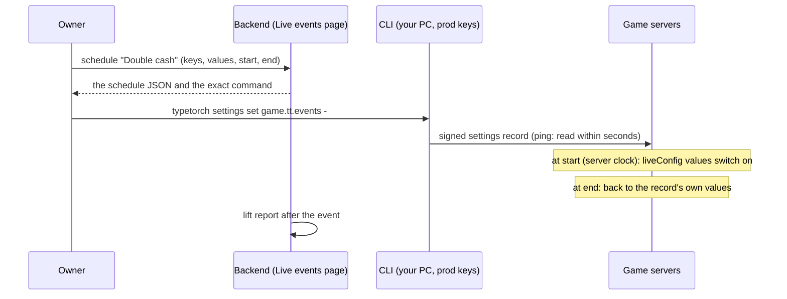

# Live events

"Double cash, Saturday 12:00 to Sunday 23:59 UTC": schedule a change of your game's live values on the explorer's
**Live events** page, sign it once with the CLI, and every game server switches it on and off at those times by
itself. Afterwards the page reports whether the event raised playtime, revenue and so on, or only moved them in time.

- Game side: framework 0.7.1+ (kernel 0.3.8+ for the signed settings record). Signing: any CLI with
  `typetorch settings set` (0.8+).
- Backend: main (unversioned). The page lives under **Players & gameplay**.

## How it works



- **The backend never signs.** Live values only reach servers through the signed settings record, and the prod keys
  stay on your machine. The backend keeps the schedule and prepares its JSON; you sign it like any other value.
- **The times are inside the signed record** (`game["tt.events"]`, unix seconds, UTC). Each server switches on its own
  clock: no message at the start or end, a server that starts mid-event has it from its first read, and an event ends
  on time even when the backend is down.
- **Cancelling** is signing the schedule without the event. Until you sign, servers still run it.

## Schedule one

On the Live events page (owners): a name, 1-8 game keys with JSON values, and a start and end. The page then shows the
command to sign the whole schedule (a bash / zsh one, a PowerShell one that reads `live-events.json`, and the JSON
file). Run it in the game's folder:

```sh
typetorch settings set game.tt.events - <<'TT_EVENTS'
{"v":1,"events":[{"id":"ev_k3j9x0a1b2","name":"Double cash","start":1763812800,"end":1763942340,"set":{"cash.multiplier":2}}]}
TT_EVENTS
```

The CLI reads the record, verifies it, sets the one key, signs it with both prod keys and pings servers
([Settings](settings.md#reserved-game-keys)).

**Checks** (the backend refuses anything else):

| Rule | Limit |
|---|---|
| Name | 1-80 characters |
| Values per event | 1-8 game keys (the CLI's key rule; not `tt.events` itself) |
| A value | JSON, not `null`, at most 1 KB |
| Start | ISO with a zone, or unix ms, whole seconds. Up to 5 minutes in the past starts now; never backdated |
| Length | at most 31 days |
| How far ahead | at most 366 days |
| Overlap | no two events on the same key at the same time (409) |
| Scheduled or live at once | at most 50 |
| The schedule | at most 8 KB (the record's whole `game` field is 16 KB) |

Servers read at most 64 events from a schedule. If two events set the same key at once, the later start wins.

**Status:** `scheduled`, `live`, `ended` (from the times) or `cancelled`. Creating and cancelling are in the
[audit log](backend-operations.md#audit-log) (`live-events.create`, `live-events.cancel`), refused ones too.

## Do servers have it?

With `OPENCLOUD_API_KEY` (`universe-datastores.objects:read`) and `TYPETORCH_UNIVERSE_ID`, the backend reads the signed
record back (at most once a minute; **Check again**, `GET /v1/live-events?refresh=1`, at most every 10 s), checks its
signature with the game's public keys when it knows them, and shows per event:

| State | Meaning |
|---|---|
| `signed` | servers have this event as scheduled |
| `outdated` | servers have it with other times or values: sign again |
| `unsigned` | not in the signed record: servers won't run it |
| `cancel-unsigned` | cancelled here but still signed: servers **will** run it until you sign |
| `done` | ended, or cancelled and gone from the signed record |
| `unknown` | the backend can't tell (no key, or signed by keys it doesn't know) |

## In game code

`liveConfig` already follows the schedule: while an event runs, its values replace the record's `game[key]`, and
`get()` and `onChanged` switch at the start and end. The game's `parse` still checks them. For UI ("Double cash ends
in 3h"), `TypeTorch.liveEvents()` (server only):

```ts
const multiplier = TypeTorch.liveConfig("cash.multiplier", { default: 1, parse: (raw) => (typeIs(raw, "number") ? raw : 1) });
multiplier.get(); // 2 while "Double cash" runs, else the record's value or 1

const events = TypeTorch.liveEvents();
events.active(); // [{ id, name, startsAt, endsAt, set }] running now
events.upcoming(); // not started yet, in start order
this.trove.add(events.onChanged((active) => this.showBanner(active)));
```

More in the [Runtime API](runtime-api.md#live-events). A client throws; send what clients need through your own
network.

## The lift report

After an event (and while it runs, cut at now), the page compares it with normal weeks:
`GET /v1/live-events/<id>/lift?weeks=3&afterDays=3`.

- **Windows:** the event; the `afterDays` (default 3) after it, to see whether players only played earlier (pulled
  forward); and the baseline, the same weekdays and hours `weeks` weeks back (default 3, at most 8). A baseline week
  that overlaps another live event is skipped for an earlier one; a week with no players is dropped.
- **Metrics per window:** players, playtime per player, sessions per player, Robux per player, payer conversion and new
  players (server-sent purchases only; Studio never counts).
- **Math:** baseline = the mean of the baseline weeks; lift = event / baseline - 1. The range is how much a normal week
  moved (each baseline week against the mean of the others). Above the range is up, below is down, inside is no clear
  change; fewer than 2 weeks is "not enough baseline". A plain band you can check by hand, not a significance test.
- **Net:** the event and after windows added up, for playtime, Robux, sessions and new players.

Example: "+20% playtime per player (baseline range -5% to +5%) ... Dip after: -7% playtime per player ... part of it
was pulled forward; net over the event and the 1 day after: +2% playtime."

Each event's start and end are also dashed lines on every time chart in the explorer, next to the
[deploy markers](explorer.md#deploy-markers). The raw numbers are the `live-event-lift` query.

## Routes

| Route | Role | What |
|---|---|---|
| `GET /v1/live-events` | every signed-in role | the events with their sync state, the schedule and the signing command |
| `POST /v1/live-events` | owners | create one |
| `POST /v1/live-events/<id>/cancel` | owners | cancel one (then sign the new schedule) |
| `GET /v1/live-events/<id>/lift` | every signed-in role | the lift report (`weeks`, `afterDays`) |
